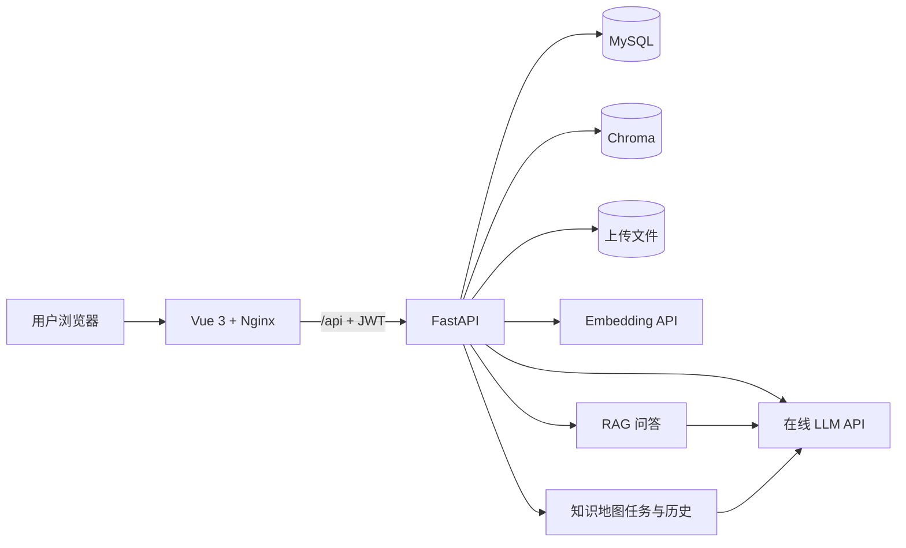

# CodeMind

CodeMind 是一个面向计算机知识学习场景的 RAG（Retrieval-Augmented Generation，检索增强生成）知识库系统。用户可以上传课程资料、实验文档和技术文档，在自己的知识库中进行语义检索，并获得带原文来源的 AI 回答。

## 功能概览

当前已实现：

- JWT 注册、登录、持久化注销撤销和用户数据隔离
- 私人知识库创建、编辑和删除
- PDF、DOCX、Markdown、TXT 文档上传
- 文档解析、文本切分和处理状态展示
- 文档任务并发防重、处理中取消、服务重启恢复和失败时旧索引保留
- 在线 Embedding API 和 Chroma 向量入库
- 问题重写、topK 检索、相似度过滤和 rerank
- 在线 LLM RAG 回答、来源编号校验和 SSE 流式输出
- 文档库、原始文档预览、片段查看与来源跳转
- 问答历史列表、详情查看和历史来源快照
- 用户反馈持久化、重复提交保护和管理员筛选查询
- 知识地图异步生成、分阶段进度、失败恢复和历史版本管理
- 总览、章节、概念、细节四类节点，以及关键记忆点和学习建议
- 节点来源核对、针对性追问、AI 分支扩展和相关资料检索
- 节点搜索定位、路径导航、本机掌握进度和继续学习入口
- 画布缩放、布局、撤销重做、分支折叠、全屏及 PNG/SVG/JSON/Markdown 导出
- 文档、向量、原始文件和知识库级联清理
- Docker Compose 本地及服务器部署
- MySQL、Chroma 就绪检查与独立存活检查
- 路由懒加载和 G6、Element Plus、文档预览独立分包

后续计划：

- 基于固定测试集继续评估不同 Embedding 模型的检索阈值
- 管理员反馈可视化页面和项目成果物整理

## 技术栈

| 层次       | 技术                               |
| ---------- | ---------------------------------- |
| 前端       | Vue 3、Vite、Element Plus、AntV G6、Axios |
| 后端       | FastAPI、Pydantic、SQLAlchemy      |
| 业务数据库 | MySQL 8.0                          |
| 向量数据库 | Chroma                             |
| 模型服务   | OpenAI 兼容 LLM API、Embedding API |
| 认证       | JWT Bearer Token                   |
| 部署       | Docker、Docker Compose、Nginx      |

## 系统架构



MySQL 保存用户、知识库、文档、片段、问答历史和反馈等结构化数据；Chroma 保存片段向量与检索 metadata；Docker 命名卷保存 MySQL 数据、原始文件和 Chroma 数据。

## 项目结构

```text
CodeMind/
├─ backend/
│  ├─ app/                 FastAPI 应用与业务服务
│  ├─ tests/               后端自动化测试
│  ├─ Dockerfile
│  └─ requirements.txt
├─ frontend/
│  ├─ src/                 Vue 页面、组件和 API 封装
│  ├─ Dockerfile
│  └─ nginx.conf
├─ database/
│  ├─ schema.sql           新数据库初始化结构
│  └─ migrations/          已有数据库升级脚本
├─ docs/                   需求、接口与项目文档
├─ storage/                非 Docker 模式下的本地持久化目录
├─ .env.example
└─ docker-compose.yml
```

## 快速开始

### 1. 环境要求

推荐使用 Docker Desktop：

- Docker Desktop 4.x 或 Docker Engine 24+
- Docker Compose v2
- 至少 4 GB 可用内存
- 可访问所配置的在线模型 API

原生开发还需要 Python 3.12 和 Node.js 22。Windows 直接安装 Chroma 依赖时可能需要 Microsoft C++ Build Tools，因此日常运行优先推荐 Docker。

### 2. 获取代码

```bash
git clone https://github.com/Attacker687/CodeMind.git
cd CodeMind
```

### 3. 配置环境变量

Docker Compose 需要根目录 `.env` 进行变量替换，后端服务读取 `backend/.env`。首次运行时创建两份配置：

Linux、macOS 或 WSL：

```bash
cp .env.example .env
cp .env.example backend/.env
```

Windows PowerShell：

```powershell
Copy-Item .env.example .env
Copy-Item .env.example backend/.env
```

至少修改以下配置：

```dotenv
MYSQL_PASSWORD=replace_with_database_password

LLM_API_KEY=replace_with_llm_api_key
LLM_BASE_URL=https://provider.example.com/v1
LLM_MODEL=replace_with_chat_model
LLM_MAX_TOKENS=1200
LLM_THINKING_BUDGET=512
CHAT_TOTAL_TIMEOUT_SECONDS=60
# Qwen3.5/Qwen3.6 留空时会自动使用非思考模式
# LLM_ENABLE_THINKING=false

# 可选：为空时复用 LLM_MODEL
MIND_MAP_MODEL=replace_with_structured_text_model
MIND_MAP_TIMEOUT_SECONDS=600
# 设为 0 表示不因整体生成较慢而中止；模型或网络真实异常仍会正常报错
MIND_MAP_TOTAL_TIMEOUT_SECONDS=0
MIND_MAP_ENABLE_THINKING=false
MIND_MAP_BATCH_MAX_TOKENS=1600
MIND_MAP_MERGE_MAX_TOKENS=4096
MIND_MAP_RETRY_MAX_TOKENS=6400

EMBEDDING_API_KEY=replace_with_embedding_api_key
EMBEDDING_BASE_URL=https://provider.example.com/v1
EMBEDDING_MODEL=replace_with_embedding_model
RETRIEVAL_SCORE_THRESHOLD=0.45

DOCUMENT_WORKER_CONCURRENCY=2

JWT_SECRET_KEY=replace_with_a_long_random_secret
```

注意事项：

- 两份文件中的 `MYSQL_PASSWORD` 应保持一致。
- `BASE_URL` 填 API 根地址，例如 `https://provider.example.com/v1`，不要填写具体的 `/chat/completions`、`/embeddings` 或 `/rerank` 路径。
- 使用 `Qwen/Qwen3.6-35B-A3B` 时，普通 RAG 默认关闭思考以避免思考过程耗尽输出额度；显式开启思考后若尚未产生正文就达到长度上限，后端会自动关闭思考重试。
- 不要提交 `.env`、`backend/.env`、API Key、JWT Secret 或数据库密码。

### 4. 构建并启动

```bash
docker compose up -d --build
docker compose ps
```

首次创建 `mysql_data` 数据卷时，MySQL 会自动执行 `database/schema.sql`。正常情况下三个容器都应进入 `healthy` 状态。

默认访问地址：

| 服务     | 地址                       |
| -------- | -------------------------- |
| 前端     | http://localhost:8080      |
| 后端 API | http://localhost:8000      |
| Swagger  | http://localhost:8000/docs |
| MySQL    | localhost:3306             |

### 5. 查看日志

```bash
docker compose logs -f backend
docker compose logs -f frontend
docker compose logs -f mysql
```

## 已有数据库升级

`database/schema.sql` 只会在 MySQL 数据卷第一次初始化时执行。拉取包含数据库结构变更的新代码后，不能只重建镜像，还需要执行对应迁移。

### 2026-07-15：任务可靠性与 JWT 注销

该迁移增加持久化 Token 版本，并允许文档进入 `cancelled` 状态。已有数据库在启动新版后端前执行一次：

Linux、macOS 或 WSL：

```bash
docker compose exec -T mysql sh -c 'mysql -uroot -p"$MYSQL_ROOT_PASSWORD" "$MYSQL_DATABASE"' \
  < database/migrations/20260715_issue13_reliability.sql
```

Windows PowerShell：

```powershell
Get-Content -Raw database\migrations\20260715_issue13_reliability.sql |
  docker compose exec -T mysql sh -c 'mysql -uroot -p"$MYSQL_ROOT_PASSWORD" "$MYSQL_DATABASE"'
```

### 2026-07-12：思维导图历史与后台任务表

该迁移创建 `mind_map_histories` 和 `mind_map_jobs`，包含业务所需的外键、索引和检查约束。已有 VPS 数据库需要在部署新版后端前执行一次：

Linux、macOS 或 WSL：

```bash
docker compose exec -T mysql sh -c 'mysql -uroot -p"$MYSQL_ROOT_PASSWORD" "$MYSQL_DATABASE"' \
  < database/migrations/20260712_create_mind_map_tables.sql
```

Windows PowerShell：

```powershell
Get-Content -Raw database\migrations\20260712_create_mind_map_tables.sql |
  docker compose exec -T mysql sh -c 'mysql -uroot -p"$MYSQL_ROOT_PASSWORD" "$MYSQL_DATABASE"'
```

### 2026-07-11：文档处理错误信息

最新文档处理流程会在 `documents.error_message` 中保存可展示的失败原因。已有数据库先执行：

Linux、macOS 或 WSL：

```bash
docker compose exec -T mysql sh -c 'mysql -uroot -p"$MYSQL_ROOT_PASSWORD" "$MYSQL_DATABASE"' \
  < database/migrations/20260711_add_document_error_message.sql
```

Windows PowerShell：

```powershell
Get-Content -Raw database\migrations\20260711_add_document_error_message.sql |
  docker compose exec -T mysql sh -c 'mysql -uroot -p"$MYSQL_ROOT_PASSWORD" "$MYSQL_DATABASE"'
```

### 2026-07-11：保留历史来源快照

该迁移为 `qa_sources` 增加文件名、片段序号和页码快照，并将文档、片段外键调整为 `ON DELETE SET NULL`。删除原文后，历史回答仍保留来源内容，但不再提供失效跳转。

执行前先备份数据库，然后运行一次：

Linux、macOS 或 WSL：

```bash
docker compose exec -T mysql sh -c 'mysql -uroot -p"$MYSQL_ROOT_PASSWORD" "$MYSQL_DATABASE"' \
  < database/migrations/20260711_preserve_qa_source_snapshots.sql
```

Windows PowerShell：

```powershell
Get-Content -Raw database\migrations\20260711_preserve_qa_source_snapshots.sql |
  docker compose exec -T mysql sh -c 'mysql -uroot -p"$MYSQL_ROOT_PASSWORD" "$MYSQL_DATABASE"'
```

该脚本是一次性迁移，已经执行过的数据库不要重复执行。

## 使用流程

1. 注册账号并登录。
2. 在“我的”页面创建知识库。
3. 在“文档上传”页面选择知识库并上传资料。
4. 等待文档状态变为 `completed`。
5. 返回“AI 问答”页面选择知识库并提问。
6. 查看回答中的来源片段和相关度。
7. 点击“查看片段”或进入“文档库”核对原文。
8. 在“问答历史”中回看回答；原文被删除后仍保留来源快照。
9. 进入“知识地图”异步生成学习结构，并查看节点类型、记忆点、学习建议和原文覆盖率。
10. 搜索或定位节点，标记本机掌握状态，对节点追问、扩展分支或导出地图。

如果检索不到资料，请先确认文档处理状态、Embedding 配置和相似度阈值。阈值与 Embedding 模型及切分粒度有关，更换模型后必须重新评估。

## API 与认证

健康检查、注册和登录接口无需 Token；其他业务接口使用：

```http
Authorization: Bearer <access_token>
```

主要接口：

| 方法           | 路径                        | 说明             |
| -------------- | --------------------------- | ---------------- |
| `POST`         | `/api/auth/register`        | 注册             |
| `POST`         | `/api/auth/login`           | 登录并获取 JWT   |
| `POST`         | `/api/auth/logout`          | 注销并撤销现有 JWT |
| `GET`          | `/api/auth/me`              | 当前用户         |
| `GET`          | `/api/health/live`          | 进程存活检查     |
| `GET`          | `/api/health/ready`         | MySQL、Chroma 就绪检查 |
| `GET/POST`     | `/api/knowledge-bases`      | 查询或创建知识库 |
| `PATCH/DELETE` | `/api/knowledge-bases/{id}` | 修改或删除知识库 |
| `POST`         | `/api/documents/upload`     | 上传文档         |
| `GET`          | `/api/documents`            | 查询文档列表     |
| `GET`          | `/api/documents/{id}`        | 查询文档详情     |
| `GET`          | `/api/documents/{id}/content` | 读取原始文档   |
| `POST`         | `/api/documents/{id}/reindex` | 重建文档索引   |
| `POST`         | `/api/documents/{id}/cancel` | 取消等待中或处理中的任务 |
| `DELETE`       | `/api/documents/{id}`       | 删除文档及向量   |
| `POST`         | `/api/search`               | 语义检索         |
| `POST`         | `/api/chat`                 | RAG 问答         |
| `POST`         | `/api/chat/stream`          | SSE 流式 RAG 问答 |
| `GET`          | `/api/qa-records`           | 问答历史列表     |
| `GET`          | `/api/qa-records/{id}`      | 问答历史详情     |
| `POST`         | `/api/qa-records/{id}/feedback` | 提交一次评分和反馈 |
| `GET`          | `/api/admin/feedbacks`      | 管理员筛选反馈   |
| `POST`         | `/api/mind-maps/jobs`       | 创建导图生成任务 |
| `GET`          | `/api/mind-maps/jobs/{id}`  | 查询任务进度     |
| `POST`         | `/api/mind-maps/generate`   | 同步生成导图（调试接口） |
| `POST`         | `/api/mind-maps/ask`        | 对导图节点追问   |
| `POST`         | `/api/mind-maps/expand`     | 扩展导图节点     |
| `GET/POST`     | `/api/mind-maps/histories`  | 查询或保存导图历史 |
| `GET/PUT/DELETE` | `/api/mind-maps/histories/{id}` | 查看、更新或删除导图历史 |

完整请求和响应模型以 Swagger 为准。

## 运行测试

在已经安装后端依赖的 Python 环境中执行：

```bash
cd backend
python -m pip install pytest==8.3.5
python -m pytest -q
```

当前后端测试共 80 项，覆盖认证和 JWT 撤销、权限、文档处理与重启恢复、取消和重复任务防护、索引事务补偿与陈旧向量过滤、反馈持久化、健康检查、删除清理、检索降级、Prompt、LLM 异常、RAG 编排、SSE 流式生成、问答历史，以及知识地图生成、JSON Mode、硬总时限、任务恢复、事务一致性、并发控制、历史和接口权限。

Docker 端到端测试已验证前端 Nginx 代理下的注册、登录、知识库创建、文档上传与解析、SSE 问答、来源返回、知识地图生成、任务重启恢复和历史详情落库。当前实测小范围知识地图约 36 秒完成，生成 15 个节点，节点数、历史记录和来源引用均通过一致性校验。

前端生产构建检查：

```bash
cd frontend
npm ci
npm run build
```

Issue #13 优化后，首屏只预加载入口和 Vue 运行时，合计约 `62.5 KiB gzip`；G6、Element Plus 和文档预览按路由独立加载。详细记录见 [前端构建优化](docs/前端构建优化.md)。

## 日常开发流程

```bash
git switch main
git pull --ff-only
git switch -c feature/your-feature
```

完成开发后：

```bash
git status
git diff --check
git add <本次修改的文件>
git commit -m "feat: describe the change"
git push -u origin feature/your-feature
```

不要把其他成员尚未提交的本地文件一起加入提交。

## 更新部署

仓库更新后通常不需要手动删除旧镜像：

```bash
git pull --ff-only
docker compose up -d --build
docker compose ps
```

Docker 会复用未变化的构建层，并重新创建代码发生变化的服务。不要执行 `docker compose down -v`，除非明确需要永久删除数据库、上传文件和 Chroma 数据。

## 数据持久化与备份

Docker Compose 使用三个命名卷：

| 数据卷            | 内容               |
| ----------------- | ------------------ |
| `mysql_data`      | MySQL 业务数据     |
| `backend_uploads` | 用户上传的原始文件 |
| `chroma_data`     | Chroma 向量数据    |

生产环境升级前至少备份 MySQL 和上传文件。更换 Embedding 模型或向量维度后，需要重新生成 Chroma 索引，不能混用不同维度的向量。

## 常见问题

### 后端提示缺少 Python 模块

确认使用了正确解释器，并安装 `backend/requirements.txt`。Windows 上 Chroma 编译失败时使用 Docker，或者安装 Microsoft C++ Build Tools。

### 上传后文档状态为 failed

查看后端日志和文档的 `error_message`。重点检查文件格式、文件内容、Embedding API Key、模型名称和网络连接。

若浏览器直接提示上传超时，请先执行 `npm ci` 并重新构建前端，确保已包含最新的上传超时配置。

服务重启时，原来的 `processing` 文档会恢复为 `pending` 并自动重新入队。重新索引失败不会先删除旧片段和旧向量；用户也可以在文档库取消 `pending` 或 `processing` 任务。

### 问题没有召回来源

确认知识库中存在 `completed` 文档，并检查相似度阈值。不要直接把其他 Embedding 模型下的阈值用于当前模型。

### 知识地图无法生成或一直等待

知识地图必须配置在线 LLM。先查看 `docker compose logs -f backend`，确认任务是否进入 `failed`，再检查 LLM 模型、超时和网络。前端会在页面切换后恢复同一知识库的未完成任务，并逐步降低轮询频率。

知识地图节点的 `node_type`、`key_points` 和 `learning_tip` 保存在历史记录的 JSON 中，不需要新增数据库列；旧历史缺少这些字段时会使用兼容默认值。

### 修改 schema.sql 后数据库没有变化

初始化脚本不会作用于已有数据卷。请执行对应的 `database/migrations/*.sql`，不要为了应用结构变化直接删除生产数据卷。

### PowerShell 中文输出乱码

可以先执行：

```powershell
[Console]::OutputEncoding = [System.Text.Encoding]::UTF8
$OutputEncoding = [System.Text.Encoding]::UTF8
```

## 项目文档

- [文档导航与实现状态](docs/README.md)
- [前端开发说明](frontend/README.md)
- [前端构建优化记录](docs/前端构建优化.md)
- [后端开发说明](backend/README.md)
- [需求分析](docs/需求分析.md)
- [API 接口设计](docs/API接口设计.md)
- [生成侧接口约定](docs/生成侧接口约定.md)
- [GitHub Wiki 首页草稿](docs/wiki/Home.md)
- [数据库结构](database/schema.sql)
- [数据库与迁移说明](database/README.md)

## 安全说明

- 公开仓库、Issue、Wiki、日志、截图和演示视频中不得出现真实密钥。
- 曾经公开过的 API Key 应立即撤销并重新生成。
- VPS 部署必须替换默认 JWT Secret 和数据库密码。
- 不要把 `.env`、数据库备份或用户上传文件提交到 Git。

## License

本项目用于课程实训。若后续需要公开发布或允许外部复用，请由项目组补充正式开源许可证。

---

文档状态：已按 Issue #13 可靠性修复同步，更新时间为 2026-07-15。
