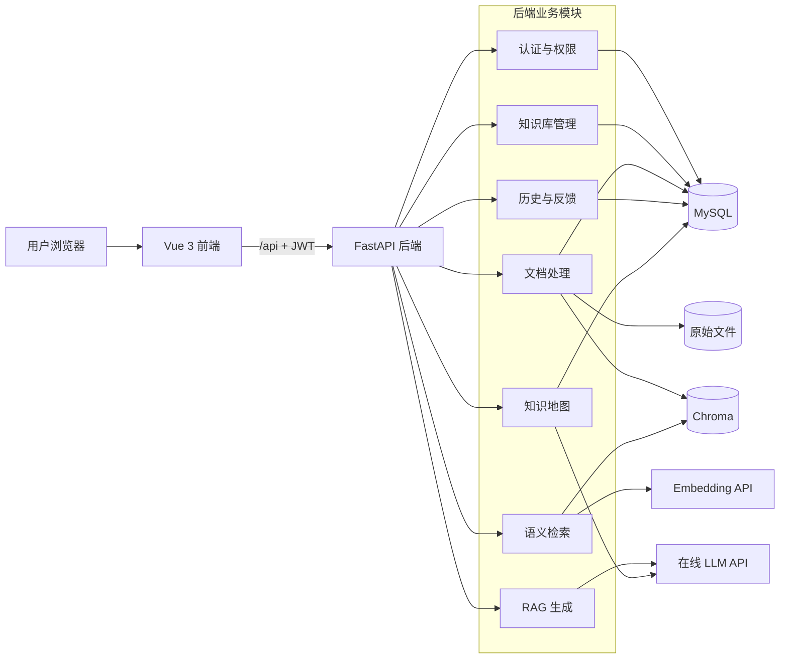
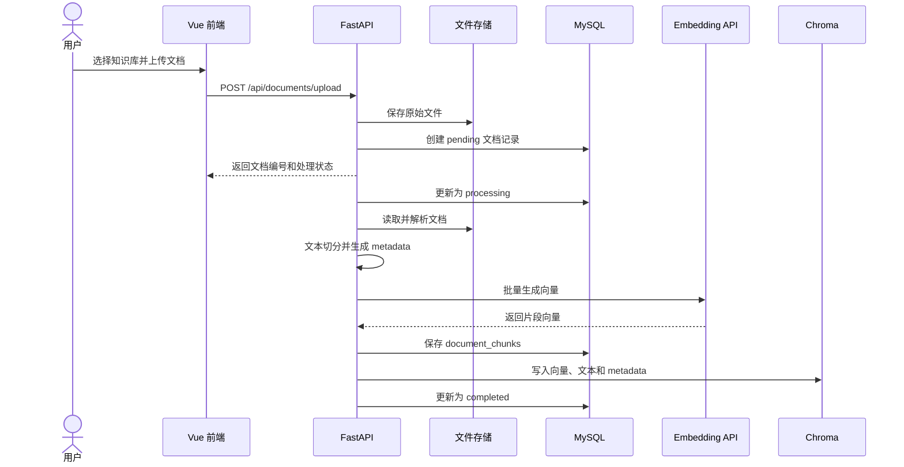
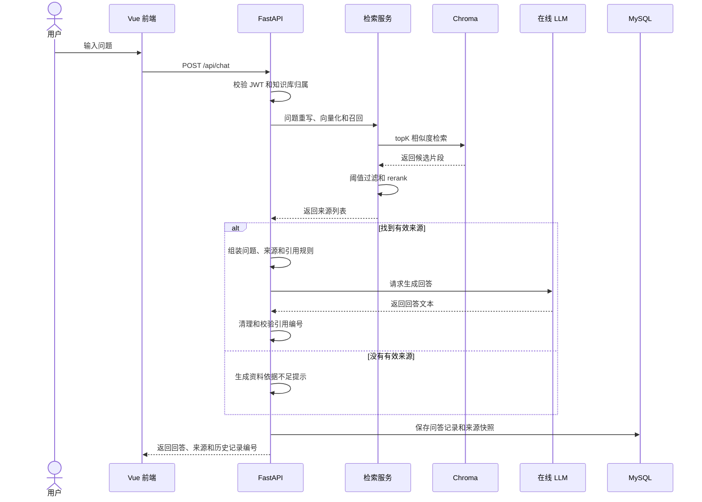
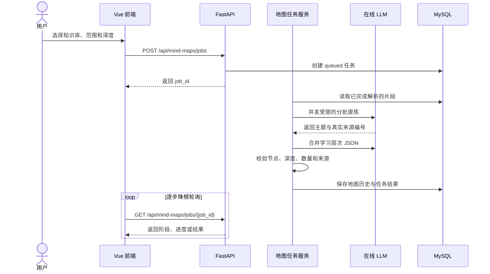
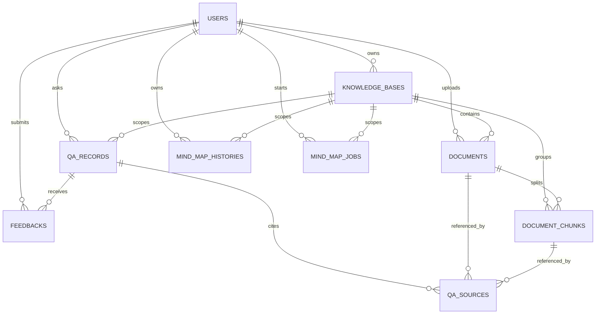

# CodeMind 项目设计与开发说明

> CodeMind 是一个面向计算机知识学习场景的 RAG 知识库问答系统。
>
> 文档依据：《CodeMind 项目设计报告》及当前 `main` 分支实现整理。

## 1. 项目简介

CodeMind 支持用户上传课程资料、实验文档和技术文档，将资料解析、切分并转换为向量后写入知识库。用户可以在指定知识库中进行语义检索、通过自然语言获得带来源引用的回答，还可以把资料生成带原文依据的知识地图。

项目希望解决以下问题：

- 个人计算机学习资料分散，查找效率较低。
- 普通关键词检索难以理解自然语言问题的真实含义。
- 通用大模型可能脱离用户资料生成缺少依据的回答。
- 回答缺少来源时，用户难以核对内容是否可靠。

CodeMind 通过 RAG（Retrieval-Augmented Generation，检索增强生成）将语义检索与在线大模型结合，使回答尽量来源于用户上传的资料，并提供可核对的文档片段。

## 2. 项目目标

- 支持多用户注册、登录和数据隔离。
- 支持创建、维护和删除个人知识库。
- 支持 PDF、DOCX、Markdown 和 TXT 文档上传。
- 支持文档解析、文本切分、Embedding 和向量入库。
- 支持按知识库进行语义检索和文档片段查看。
- 支持基于检索结果生成带来源引用的 RAG 回答。
- 支持保存问题、回答和来源快照，供用户查看历史记录。
- 支持生成可追溯的知识地图，对节点追问、扩展、搜索、导航和复习。
- 支持 Docker Compose 本地部署和 VPS 部署。

## 3. 技术选型

| 层次 | 技术 | 主要用途 |
| --- | --- | --- |
| 前端 | Vue 3、Vite、Element Plus、AntV G6、Axios | 页面、路由、知识地图画布和接口调用 |
| 后端 | FastAPI、Pydantic、SQLAlchemy | REST API、业务编排、参数校验和数据库访问 |
| 业务数据库 | MySQL 8.0 | 用户、知识库、文档、片段、历史和反馈 |
| 向量数据库 | Chroma | 文档片段向量存储和相似度召回 |
| 模型服务 | OpenAI 兼容在线 API | LLM 回答生成和 Embedding |
| 认证 | JWT Bearer Token | 登录状态和受保护接口访问 |
| 部署 | Docker、Docker Compose、Nginx | 服务构建、编排和前端反向代理 |

## 4. 系统角色

| 角色 | 主要能力 |
| --- | --- |
| 普通用户 | 注册登录、管理知识库、上传资料、语义检索、RAG 提问、查看来源和历史、生成知识地图 |
| 管理员 | 通过受保护 API 查看和筛选系统反馈；可视化管理页面仍待完成 |
| 外部模型服务 | 提供文本向量和回答生成能力 |

## 5. 系统架构



系统将数据分为三类：

- MySQL 保存结构化业务数据、用户归属和权限信息。
- Chroma 保存片段向量、片段文本和检索 metadata。
- 上传目录保存用户上传的原始文件。

这种划分使业务数据、向量数据和原始资料彼此独立，便于维护、备份和替换模型服务。

## 6. 功能模块

### 6.1 用户认证与权限

- 用户可以使用用户名、邮箱和密码注册。
- 密码以哈希形式保存，不保存明文密码。
- 登录成功后返回 JWT Access Token。
- 退出登录会递增持久化 Token 版本，使当前 JWT 立即失效。
- 前端通过 `Authorization: Bearer <token>` 访问受保护接口。
- 后端根据 Token 中的用户身份校验知识库、文档和历史记录归属。
- 用户只能访问自己的私人数据。

### 6.2 知识库管理

- 创建、查询、修改和删除知识库。
- 保存知识库名称、描述、可见范围和所属用户。
- 当前仅开放私人知识库。
- 同一用户不能创建重名知识库。
- 删除知识库时，同时清理关联文档、片段、向量和原始文件。

### 6.3 文档上传与处理

- 支持 PDF、DOCX、Markdown 和 TXT。
- 校验文件类型、文件名、文件大小和空文件。
- 保存原始文件并在 MySQL 中创建文档记录。
- 记录 `pending`、`processing`、`completed`、`failed`、`cancelled` 处理状态。
- 提取文本并按自然边界切分片段。
- 调用 Embedding API 生成片段向量。
- 将片段写入 MySQL，将向量及 metadata 写入 Chroma。
- 支持取消、重新构建文档索引和删除文档。
- 后台任务原子领取，同一文档不会重复处理；服务重启会自动恢复中断任务。
- 重建在新索引成功后才替换旧索引，失败或取消时旧索引继续可用。

### 6.4 语义检索

- 将用户问题转换为向量。
- 按 `owner_id` 和 `knowledge_base_id` 限定检索范围。
- 使用 Chroma 进行余弦相似度召回。
- 支持 `top_k`、相似度阈值、问题重写和 rerank 参数。
- 返回文档、片段、页码、相关度、原文和跳转地址。

相似度阈值与 Embedding 模型和切分粒度密切相关。更换模型后应使用项目测试集重新评估阈值，不能直接沿用旧模型参数。
当前针对 `Qwen/Qwen3-VL-Embedding-8B`、4096 维向量的默认值为 `0.45`。

### 6.5 RAG 问答

- 获取检索侧返回的候选来源。
- 将原始问题、重写问题和来源片段组装为 Prompt。
- 限制单条来源和总上下文长度。
- 要求模型只依据知识库资料回答。
- 要求关键结论使用 `[来源N]` 标注。
- 清理不存在或格式错误的引用编号。
- 没有足够资料时，明确返回“知识库中未找到足够依据”。
- 对模型认证、限流、超时和服务异常返回明确错误。

### 6.6 来源引用与原文跳转

每条来源至少包括：

| 字段 | 说明 |
| --- | --- |
| `document_id` | 来源文档编号 |
| `chunk_id` | 来源片段编号 |
| `file_name` | 文件名 |
| `chunk_index` | 片段在文档中的顺序 |
| `page_no` | 页码，无法识别时为空 |
| `score` | 语义相似度或综合排序分数 |
| `source_text` | 作为回答依据的片段快照 |
| `jump_url` | 文档片段查看地址 |

用户可以从回答来源打开对应文档片段，核对回答依据。

### 6.7 问答历史与反馈

- 保存用户问题、重写问题、回答、来源数量和创建时间。
- 保存来源顺序、分数和片段快照。
- 支持按知识库查询历史列表。
- 支持查看单条历史记录及其来源。
- 删除原文后仍保留来源文件名、位置和文本快照，失效跳转会隐藏。
- 问答历史前端列表和详情页已经完成。
- 支持 1 至 5 分评分和文字评价，校验问答归属并持久化到 MySQL。
- 同一用户对同一问答只能反馈一次；管理员可按评分、用户和知识库筛选。

### 6.8 知识地图

- 可选择整个知识库或单个已完成解析的文档生成地图。
- 后端以后台任务执行，记录排队、读取、分批提炼、合并、校验和组装进度。
- 分批分析共享并发限制，失败时取消剩余模型请求。
- 节点分为总览、章节、概念和细节，可包含摘要、关键记忆点、学习建议和真实来源。
- 支持针对节点来源提问，以及根据来源扩展子节点。
- 自动生成后保存历史，用户也可以新建、更新、打开和删除地图版本。
- 前端支持学习概览、知识层级、叶子节点、原文覆盖率、本机掌握进度和继续学习入口。
- 画布支持搜索定位、知识路径、缩放、适应画布、重新布局、撤销重做、位置锁定、分支折叠和全屏。
- 支持导出 PNG、SVG、JSON 和包含记忆点、学习建议的 Markdown 大纲。

最近合并的 PR #11 增加了 `node_type`、`key_points` 和 `learning_tip`。这些字段保存在地图历史 JSON 中并提供默认值，旧历史不需要数据库迁移即可读取。

## 7. 核心业务流程

### 7.1 文档入库流程



任一步骤失败时，系统应回滚可回滚的数据、清理已写入向量，并将文档状态更新为 `failed`。

### 7.2 RAG 问答流程



### 7.3 知识地图生成流程



## 8. 数据库设计

### 8.1 数据关系



### 8.2 主要数据表

| 表名 | 用途 |
| --- | --- |
| `users` | 用户名、邮箱、密码哈希、角色、状态和 Token 版本 |
| `knowledge_bases` | 知识库名称、描述、范围和用户归属 |
| `documents` | 文件信息、存储路径、处理状态和片段数量 |
| `document_chunks` | 片段文本、位置、页码和 Chroma `vector_id` |
| `qa_records` | 问题、重写问题、回答和来源数量 |
| `qa_sources` | 回答引用的片段、顺序、分数和文本快照 |
| `feedbacks` | 用户评分和文字反馈 |
| `mind_map_histories` | 地图结果 JSON、标题、节点数和画布状态 |
| `mind_map_jobs` | 生成任务状态、阶段、进度、结果和失败原因 |

### 8.3 Chroma metadata

每条向量至少保存：

- `owner_id`
- `knowledge_base_id`
- `document_id`
- `chunk_id`
- `chunk_index`
- `file_name`
- `page_no`
- `start_offset`
- `end_offset`

`document_chunks.vector_id` 与 Chroma 向量编号一一对应，用于结构化数据和向量数据之间的关联。

## 9. API 概览

除健康检查、注册和登录外，受保护接口都需要 JWT Bearer Token。

| 模块 | 方法与路径 | 说明 | 当前状态 |
| --- | --- | --- | --- |
| 健康检查 | `GET /api/health/live` | 检查 API 进程存活 | 已实现 |
| 健康检查 | `GET /api/health/ready` | 检查 MySQL 和 Chroma 就绪 | 已实现 |
| 认证 | `POST /api/auth/register` | 注册用户 | 已实现 |
| 认证 | `POST /api/auth/login` | 登录并获取 Token | 已实现 |
| 认证 | `POST /api/auth/logout` | 注销并撤销现有 Token | 已实现 |
| 认证 | `GET /api/auth/me` | 获取当前用户 | 已实现 |
| 知识库 | `GET /api/knowledge-bases` | 查询个人知识库 | 已实现 |
| 知识库 | `POST /api/knowledge-bases` | 创建知识库 | 已实现 |
| 知识库 | `PATCH /api/knowledge-bases/{id}` | 修改知识库 | 已实现 |
| 知识库 | `DELETE /api/knowledge-bases/{id}` | 删除知识库及关联数据 | 已实现 |
| 文档 | `POST /api/documents/upload` | 上传并处理文档 | 已实现 |
| 文档 | `GET /api/documents` | 查询文档列表 | 已实现 |
| 文档 | `GET /api/documents/{id}` | 查询文档详情 | 已实现 |
| 文档 | `DELETE /api/documents/{id}` | 删除文档、向量和文件 | 已实现 |
| 文档 | `POST /api/documents/{id}/reindex` | 重建文档索引 | 已实现 |
| 文档 | `POST /api/documents/{id}/cancel` | 取消等待中或处理中的任务 | 已实现 |
| 文档 | `GET /api/documents/{id}/chunks` | 查询文档片段 | 已实现 |
| 检索 | `POST /api/search` | 直接语义检索 | 已实现 |
| 问答 | `POST /api/chat` | RAG 问答 | 已实现 |
| 历史 | `GET /api/qa-records` | 查询问答历史 | 已实现 |
| 历史 | `GET /api/qa-records/{id}` | 查询历史详情 | 已实现 |
| 知识地图 | `POST /api/mind-maps/jobs` | 创建后台生成任务 | 已实现 |
| 知识地图 | `GET /api/mind-maps/jobs/{id}` | 查询任务进度和结果 | 已实现 |
| 知识地图 | `POST /api/mind-maps/ask` | 节点追问 | 已实现 |
| 知识地图 | `POST /api/mind-maps/expand` | 节点扩展 | 已实现 |
| 知识地图 | `/api/mind-maps/histories` | 地图历史增删改查 | 已实现 |
| 反馈 | `POST /api/qa-records/{id}/feedback` | 校验归属并持久化反馈 | 已实现 |
| 管理 | `GET /api/admin/feedbacks` | 按评分、用户、知识库筛选 | 已实现 |

完整交互文档可在后端运行后访问：`http://localhost:8000/docs`。

## 10. 安全设计

- 用户密码只保存哈希值。
- 使用 JWT 校验登录身份。
- 注销通过数据库 Token 版本立即撤销既有 JWT。
- 知识库、文档、片段和历史查询都校验用户归属。
- 上传文件限制扩展名、文件大小并处理危险文件名字符。
- API Key、JWT Secret 和数据库密码通过环境变量配置。
- 前端代码、Git 仓库、Wiki、截图和演示视频中不得出现真实密钥。
- 知识库片段被视为不可信数据，Prompt 明确禁止执行片段中的指令。
- 模型返回的来源编号需要经过后端校验和清理。

## 11. 本地部署

### 11.1 准备环境变量

在仓库根目录执行：

```bash
cp .env.example .env
cp .env.example backend/.env
```

Windows PowerShell：

```powershell
Copy-Item .env.example .env
Copy-Item .env.example backend/.env
```

Docker Compose 使用根目录 `.env` 做变量替换，后端容器读取 `backend/.env`。两份文件中的 `MYSQL_PASSWORD` 必须保持一致；模型、JWT 等后端配置填写在 `backend/.env`：

```dotenv
MYSQL_HOST=mysql
MYSQL_PORT=3306
MYSQL_USER=root
MYSQL_PASSWORD=replace_with_database_password
MYSQL_DATABASE=codemind

LLM_API_KEY=replace_with_llm_key
LLM_BASE_URL=https://provider.example.com/v1
LLM_MODEL=replace_with_chat_model
LLM_MAX_TOKENS=1200
LLM_THINKING_BUDGET=512
# Qwen3.5/Qwen3.6 留空时自动使用非思考模式
# LLM_ENABLE_THINKING=false

MIND_MAP_MODEL=
MIND_MAP_ENABLE_THINKING=false
MIND_MAP_BATCH_MAX_TOKENS=1600
MIND_MAP_MERGE_MAX_TOKENS=4096
MIND_MAP_RETRY_MAX_TOKENS=6400

EMBEDDING_API_KEY=replace_with_embedding_key
EMBEDDING_BASE_URL=https://provider.example.com/v1
EMBEDDING_MODEL=replace_with_embedding_model

JWT_SECRET_KEY=replace_with_a_long_random_secret
JWT_ALGORITHM=HS256
JWT_EXPIRE_MINUTES=180
```

不要将 `.env`、`backend/.env`、API Key、JWT Secret 或数据库密码提交到 Git。

### 11.2 启动服务

```bash
docker compose up -d --build
docker compose ps
```

默认访问地址：

| 服务 | 地址 |
| --- | --- |
| 前端 | `http://localhost:8080` |
| 后端 API | `http://localhost:8000` |
| Swagger | `http://localhost:8000/docs` |
| MySQL | `localhost:3306` |

### 11.3 查看日志

```bash
docker compose logs -f backend
docker compose logs -f frontend
docker compose logs -f mysql
```

### 11.4 停止服务

```bash
docker compose down
```

普通停止不会删除 MySQL、上传文件和 Chroma 数据卷。只有明确需要清空数据时才可执行带 `-v` 的删除命令。

## 12. 测试与验收

### 12.1 自动化测试

后端测试覆盖：

- 应用启动、liveness、MySQL/Chroma readiness 和依赖故障。
- 注册、登录、密码哈希、JWT 和注销撤销。
- 文档处理、原子领取、重复防护、取消、启动恢复和失败回滚。
- 文档、向量和知识库删除。
- Prompt 组装和引用编号清理。
- LLM 错误转换。
- RAG 有来源和无来源流程。
- 问答历史保存、查询、事务回滚和用户隔离。
- 删除文档后来源快照保留。
- 反馈持久化、重复保护、越权拒绝和管理员筛选。
- 知识地图生成、来源校验、并发限制和失败取消。
- 知识地图任务、历史事务和文档归属校验。

当前后端自动化测试基线为 80 项。

### 12.2 核心验收流程

1. 注册并登录用户。
2. 创建私人知识库。
3. 上传测试文档。
4. 等待文档状态变为 `completed`。
5. 查询文档片段并验证片段数量。
6. 使用资料中的问题进行语义检索。
7. 提交 RAG 问题并检查回答和来源。
8. 点击来源跳转到对应文档片段。
9. 查看问答历史及来源快照。
10. 生成知识地图并观察任务进度、节点来源、关键记忆点和学习建议。
11. 测试节点搜索、追问、扩展、历史保存和导出。
12. 删除文档或知识库，检查 MySQL、Chroma、文件和历史快照行为。
13. 提交反馈并验证重复提交、其他用户越权和管理员筛选行为。
14. 注销后验证旧 JWT 失效，并验证 MySQL 或 Chroma 故障时 readiness 返回 `503`。
15. 使用另一个用户验证资源不能被越权访问。

### 12.3 回答质量评估

建议建立固定测试集，至少包含：

- 资料中可以直接回答的问题。
- 需要多个片段综合回答的问题。
- 表述不同但语义相同的问题。
- 资料中不存在答案的问题。
- 可能诱导模型脱离资料回答的问题。
- 文档中包含提示词注入内容的问题。

评估指标包括检索召回率、来源匹配度、回答正确性、拒答合理性和响应时间。

## 13. 非功能性要求

### 13.1 性能

- 普通业务查询应保持较短响应时间。
- 文档处理使用状态字段反馈进度，避免用户误判。
- 模型调用设置超时、有限重试和明确错误提示。
- 首屏仅加载入口和 Vue 运行时，G6、Element Plus 和文档预览按路由加载。
- 实训规模下应支持多用户资料管理和连续问答测试。

### 13.2 可维护性

- 前后端请求字段、数据库字段和文档保持一致。
- MySQL、Chroma、文件存储和模型服务职责清晰。
- 模型、阈值和 Prompt 参数应集中管理。
- 数据库结构更新需要迁移脚本，不能只修改初始化建表文件。

### 13.3 可追溯性

- 回答返回真实来源，不生成不存在的来源编号。
- 历史记录保存来源片段快照。
- 原文仍存在时支持跳转核对。
- 原文被删除后仍应保留历史快照，并明确标记原文不可用。

## 14. 当前进度与后续计划

### 14.1 已完成

- 前后端基础工程和 Docker Compose 部署。
- JWT 注册、登录和资源权限校验。
- 知识库及文档管理。
- PDF、DOCX、Markdown、TXT 解析和切分。
- Embedding 与 Chroma 入库。
- 问题重写、相似度过滤和 rerank 流程。
- RAG Prompt、在线 LLM 调用和来源引用。
- 问答历史后端保存及查询。
- 问答历史前端页面和删除原文后的来源快照。
- 文档和知识库删除业务。
- 知识地图异步任务、历史版本、节点追问和节点扩展。
- 知识地图学习层次、记忆点、学习建议、掌握进度、搜索导航和导出。
- 文档任务防重、取消、重启恢复和失败时旧索引保护。
- 反馈持久化、管理员筛选、JWT 注销撤销和 MySQL/Chroma 就绪检查。
- 前端路由懒加载和重依赖独立分包。

### 14.2 待完成或待优化

- 使用固定测试集重新评估相似度阈值。
- 完成管理员反馈可视化页面。
- 增加真实 MySQL、Chroma 和在线模型端到端测试及质量评估记录。
- 完成项目报告、PPT、演示视频和部署文档。

## 15. 小组分工

| 方向 | 负责人 | 主要职责 |
| --- | --- | --- |
| 前端与数据库设计 | 李翰坤 | Vue 页面、交互、路由、接口对接、MySQL 表结构和 Chroma metadata |
| 后端入库流程 | 龚仕豪 | 文件上传、解析、切分、Embedding、向量入库和处理状态 |
| 提问流程检索侧 | 李竺桓 | 问题重写、问题向量化、topK 检索、阈值过滤和 rerank |
| 提问流程生成侧 | 王瀚铖 | 上下文组装、Prompt、LLM 回答、来源引用和问答历史 |
| 用户、文档访问与整合测试 | 邓智元 | 注册登录、权限、直接搜索、引用跳转和接口联调 |

模块负责人负责本模块实现和测试，同时需要共同完成接口联调、部署、文档和最终答辩。

## 16. 仓库导航

- [项目仓库](https://github.com/Attacker687/CodeMind)
- [后端代码](https://github.com/Attacker687/CodeMind/tree/main/backend)
- [前端代码](https://github.com/Attacker687/CodeMind/tree/main/frontend)
- [数据库结构](https://github.com/Attacker687/CodeMind/blob/main/database/schema.sql)
- [需求分析](https://github.com/Attacker687/CodeMind/blob/main/docs/%E9%9C%80%E6%B1%82%E5%88%86%E6%9E%90.md)
- [API 接口设计](https://github.com/Attacker687/CodeMind/blob/main/docs/API%E6%8E%A5%E5%8F%A3%E8%AE%BE%E8%AE%A1.md)
- [生成侧接口约定](https://github.com/Attacker687/CodeMind/blob/main/docs/%E7%94%9F%E6%88%90%E4%BE%A7%E6%8E%A5%E5%8F%A3%E7%BA%A6%E5%AE%9A.md)
- [文档导航与实现状态](https://github.com/Attacker687/CodeMind/blob/main/docs/README.md)

## 17. 文档维护约定

- 功能、接口或数据库发生变化时，同步更新 Wiki。
- 已实现和规划中的功能必须明确区分。
- 不在 Wiki 中粘贴密码、Token、API Key 或完整 `.env`。
- 测试结果应注明测试日期、代码提交和模型配置。
- 重要架构决策通过 GitHub Issue 讨论并保留记录。

---

最后更新：2026 年 7 月 15 日；实现基线：Issue #13 可靠性修复。
